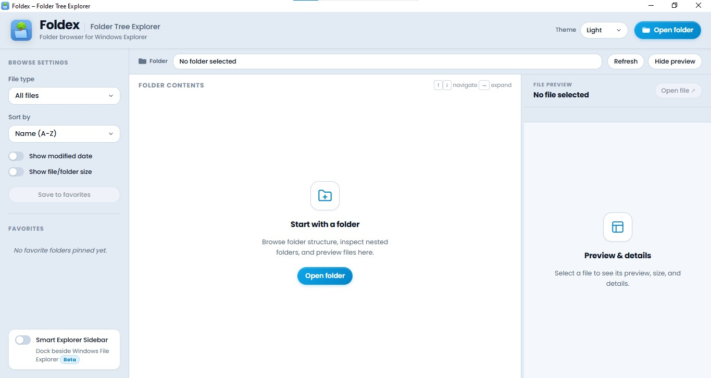
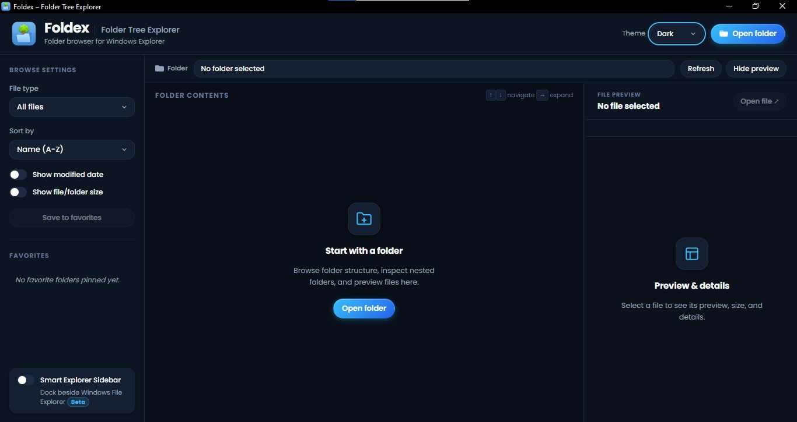
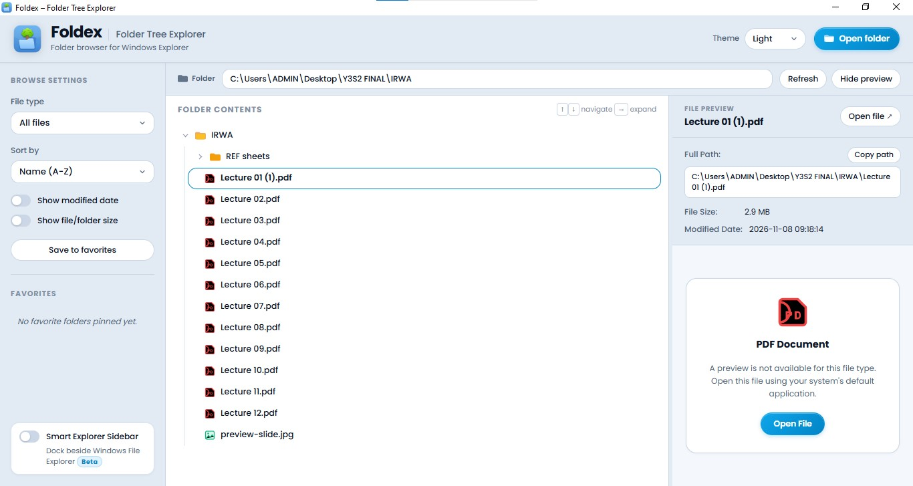
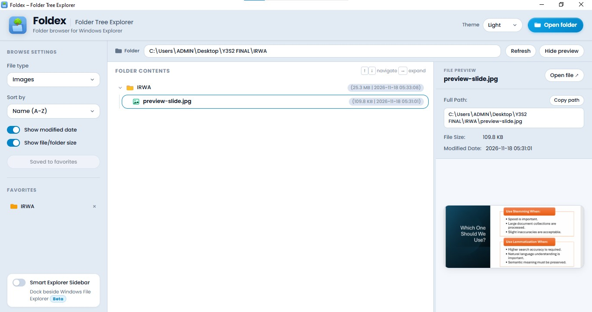
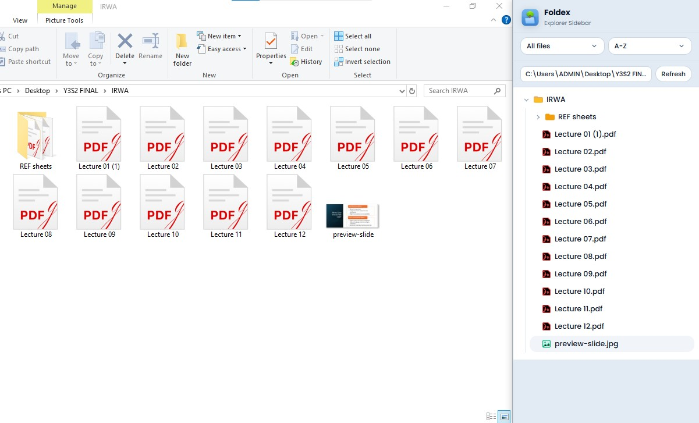
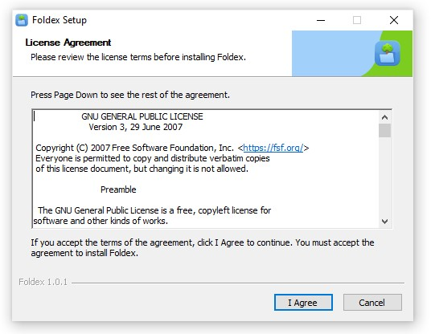
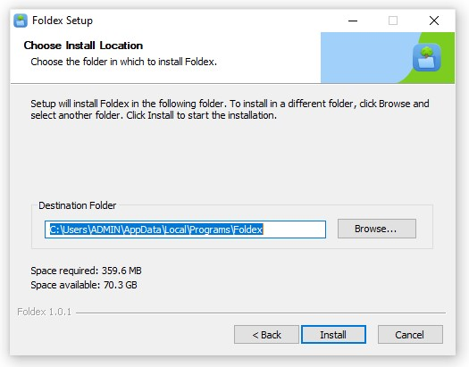
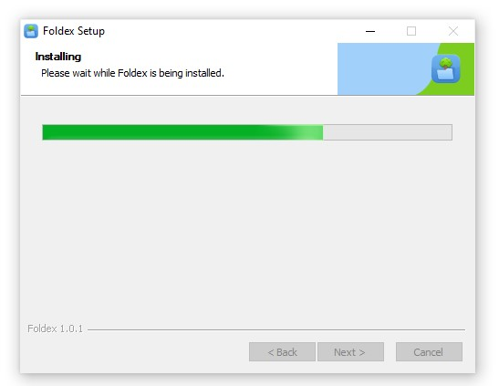
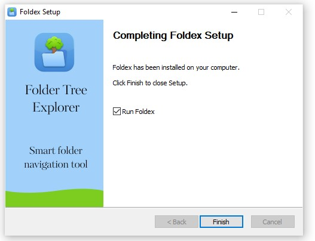
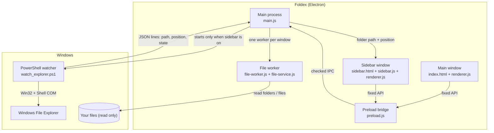

# 🌳 Foldex – Folder Tree Explorer

[](#-versions)
[](#-system-requirements)
[](https://www.electronjs.org/)
[](LICENSE)

**Foldex is a small Windows app that shows any folder as a clear, expandable tree, so you can find your files without opening folder after folder.**

<p align="center">
  
</p>

<details>
<summary><b>🌙 Show the dark theme preview</b></summary>
<br>
<p align="center">
  
</p>
</details>

---

## 📑 Contents

- [What is Foldex?](#-what-is-foldex)
- [Why Foldex? (The problem)](#-why-foldex-the-problem)
- [How Foldex helps](#-how-foldex-helps)
- [Features](#-features)
- [Screenshots](#-screenshots)
- [Installation](#-installation)
- [How to use](#-how-to-use)
- [Smart Explorer Sidebar (Beta)](#-smart-explorer-sidebar-beta)
- [Security – how safe is Foldex?](#-security--how-safe-is-foldex)
- [Privacy and your data](#-privacy-and-your-data)
- [Technical details](#-technical-details)
- [Run and build from source](#-run-and-build-from-source)
- [Versions](#-versions)
- [Known limitations](#-known-limitations)
- [Feedback and contributing](#-feedback-and-contributing)
- [License](#-license)

---

## 🌳 What is Foldex?

Foldex is a **folder browser for Windows**. You pick a folder, and Foldex shows everything inside it as a **tree**: folders inside folders inside folders, all on one screen. Click a folder to open it in place, click a file to see a preview and its details.

It does **not** replace Windows File Explorer. It works next to it as a helper that makes looking through big, messy folders much faster.

---

## 😩 Why Foldex? (The problem)

Most of us have folders like these:

- University or work folders with **many sub folders** (`Year 3 → Semester 2 → Subject → Lectures → Week 05 → ...`)
- Project folders with **hundreds or thousands of files**
- Download and document folders that grew for years

When you need one file, you often **forget where you saved it**. Then you have to:

1. Open a folder in File Explorer.
2. Look inside. Not there.
3. Go back. Open the next folder.
4. Repeat again and again through every nested level...

Or you try **Windows search**, which can be slow, needs the exact file name, and shows results without showing *where* they sit in your folder structure.

This back and forth wastes time and is honestly a headache.

---

## 💡 How Foldex helps

Foldex removes that headache:

| Without Foldex | With Foldex |
| --- | --- |
| Open each folder one by one to see what is inside | See the full folder tree on one screen and expand any level with one click |
| Lose track of where you are in deep folders | The tree always shows the path from the top folder down to your file |
| Search needs the exact name | Filter the whole tree by file type (for example *only PDFs* or *only images*) |
| Open files in other apps just to check them | Preview images, videos, audio and text/code files inside Foldex |
| No idea which folders are the biggest | Turn on sizes and dates and sort by size or date |
| Re-open the same deep folders every day | Save them to **Favorites** and open them in one click |

---

## ✨ Features

### 🌲 Folder tree
- Shows any folder as an expandable tree. Folders always appear before files.
- Sub folders load only when you open them, so even huge folders open quickly.
- Large scans run in the background with a progress bar and a **Cancel** button.
- Folders that cannot be read (for example, no permission) are skipped and you get a short notice.

### 🔍 Filter and sort
- **Filter by file type:** All files, Images, PNG, JPG/JPEG, PDF, Word, Excel/CSV, PowerPoint.
  When a filter is on, folders that do not contain any matching file (at any depth) are hidden, so you only walk the paths that lead to what you want.
- **Sort by:** name (A–Z / Z–A), size (smallest / largest first), or date modified (oldest / newest first).
- **Show modified date** and **Show file/folder size** switches. Folder sizes include everything inside them.

### 👀 File preview
Click a file to see its full path, size and modified date, plus a preview:

| Type | Preview |
| --- | --- |
| Images | `.png` `.jpg` `.jpeg` `.gif` `.webp` `.svg` |
| Video | `.mp4` `.webm` `.mkv` |
| Audio | `.mp3` `.wav` `.ogg` |
| Text and code | `.txt` `.md` `.js` `.ts` `.json` `.html` `.css` `.py` `.cpp` `.h` `.ini` `.cfg` `.xml` `.yaml` `.yml` `.bat` `.sh` (first 50 KB, with line numbers) |
| Everything else (PDF, Word, Excel, ...) | A file card with an **Open File** button that opens it in your normal Windows app |

- **Copy path** button to copy the full file path.
- The preview panel can be **resized** by dragging its edge, or **hidden** with *Hide preview*.

### ⭐ Favorites
- Save the current folder with **Save to favorites**.
- Favorites stay saved after you close the app. Remove one with the **×** button.

### 🎨 Look and feel
- **Light** and **Dark** themes (the Windows title bar follows the theme too).
- Clean layout with the Poppins font and file-type icons.
- The current version number is shown at the bottom of the left panel.

### ⌨️ Keyboard friendly
See [Keyboard shortcuts](#keyboard-shortcuts).

### 🪟 Smart Explorer Sidebar *(Beta)*
A small Foldex panel that sticks to the right side of Windows File Explorer and shows the tree of the folder you have open there. See [Smart Explorer Sidebar](#-smart-explorer-sidebar-beta).

---

## 📸 Screenshots

### Browsing a folder and checking a file
Open a folder, expand it, and click a file to see its details. Files without a built-in preview (like PDFs) show an **Open File** button.

<p align="center">
  
</p>

### Filter, sizes, dates and favorites
Here the filter is set to **Images**, so only the folder path that leads to an image is shown. Sizes and dates are on, and the folder is saved in **Favorites**.

<p align="center">
  
</p>

### Smart Explorer Sidebar *(Beta – currently under testing)*

> ⚠️ **Beta:** the sidebar is still being tested. It works, but you may notice small issues such as a short delay when moving the Explorer window. See [Known limitations](#-known-limitations).

<p align="center">
  
</p>

---

## 📥 Installation

### System requirements
- Windows 10 or Windows 11 (64-bit)
- About 360 MB of free disk space
- No admin rights needed (unless you choose to install for all users)

### Step 1 – Download
Download the latest **`Foldex-Setup-x.x.x.exe`** from the [Releases page](https://github.com/Danidu-Muhandiram/Windows-Explorer-Folder-Tree/releases).

> If there is no release yet, you can build the installer yourself. See [Run and build from source](#-run-and-build-from-source).

### Step 2 – Run the installer (Windows SmartScreen)
Double-click the downloaded file.

Because Foldex is a free project and the installer is **not code-signed** (signing certificates cost money), Windows may show a blue **"Windows protected your PC"** window. This is normal for small independent apps.

1. Click **More info**.
2. Click **Run anyway**.

> Only do this if you downloaded the file from this project's official GitHub page. If you want to be 100% sure, build it yourself from the source code.

### Step 3 – Accept the license
The installer shows the **GNU GPL v3.0** license. It explains what you can do with Foldex and that it comes without any warranty. Read it, then click **I Agree**.

<p align="center">
  
</p>

### Step 4 – Choose who to install for
The installer asks **who should be able to use Foldex**:

- **Only for me** *(recommended)* – installs just for your Windows user. No admin password needed.
- **Anyone who uses this computer** – installs for all users. Windows will ask for admin permission.

Click **Next**.

### Step 5 – Choose the install folder
The default folder is fine for most people:
`C:\Users\<you>\AppData\Local\Programs\Foldex`

Click **Browse...** if you want a different place, then click **Install**.

<p align="center">
  
</p>

### Step 6 – Wait for the install to finish
This takes a few seconds.

<p align="center">
  
</p>

### Step 7 – Finish
Leave **Run Foldex** ticked if you want to open it right away, then click **Finish**.

<p align="center">
  
</p>

The installer adds:
- A **Foldex** shortcut on your Desktop
- A **Foldex** entry in the Start menu
- A **Foldex** entry in *Settings → Apps* (for uninstalling)

### Updating to a new version
Download the newer installer and run it. It **replaces the old version automatically** – you do not need to uninstall first. Your theme and favorites are kept.

> Upgrading from the older name **"Folder Tree Explorer"**? Just install Foldex. It replaces the old app and its shortcuts.

### Uninstalling
Go to **Settings → Apps → Installed apps → Foldex → Uninstall**.
(If the sidebar had narrowed any Explorer windows, close Foldex first so they go back to their normal size.)

---

## 🚀 How to use

1. Open **Foldex**.
2. Click **Open folder** and choose a folder.
3. Click the arrow next to a folder (or the folder name) to expand it.
4. Click a file to see its preview and details on the right.
5. Use **File type** and **Sort by** on the left to narrow down the tree.
6. Turn on **Show modified date** / **Show file/folder size** if you need them.
7. Click **Save to favorites** to keep this folder in your Favorites list.
8. Click **Open file ↗** (or **Open File**) to open the selected file in its normal Windows app.

### Keyboard shortcuts

| Key | Action |
| --- | --- |
| `↑` / `↓` | Move up / down in the tree |
| `→` | Expand a folder (or go into it if already open) |
| `←` | Collapse a folder (or go to its parent) |
| `Home` / `End` | Jump to the first / last item |
| `Enter` / `Space` | Open/close a folder, or select a file |
| `F5` or `Ctrl + R` | Refresh the tree |
| `Esc` | Cancel a running scan |
| `←` / `→` on the preview divider | Make the preview panel wider / narrower |

---

## 🪟 Smart Explorer Sidebar (Beta)

> ⚠️ **This feature is in Beta and currently under testing.** Please [report any problems](#-feedback-and-contributing) you find.

The sidebar is a slim Foldex panel that **docks to the right side of Windows File Explorer**. When you move to another folder in File Explorer, the sidebar shows the tree of that folder automatically.

### How to use it
1. In Foldex, turn on **Smart Explorer Sidebar** (bottom left).
2. Open or click on any File Explorer window.
3. Foldex makes the Explorer window a little narrower and places the sidebar in the free space.
4. Browse in Explorer as usual – the sidebar follows the folder you are in.
5. In the sidebar you can filter, sort, refresh and expand folders. **Clicking a file opens it** in its normal app.
6. Turn the switch off (or close Foldex) to remove the sidebar. Explorer windows go back to their original size.

### Good to know
- The sidebar follows **the File Explorer window you used last**.
- It hides when that Explorer window is minimized or closed.
- It uses the same theme as the main Foldex window.

---

## 🔒 Security – how safe is Foldex?

Foldex was built to be **safe by design**. In simple words:

### ✅ It only reads your files
Foldex **never creates, edits, renames, moves or deletes** any of your files or folders. It only reads folder lists, file sizes and dates, and the first part of text files for the preview.

### ✅ It works fully offline
Foldex does **not connect to the internet**. There are no accounts, no ads, no tracking, no analytics and no automatic uploads. The app's pages are even blocked from making network requests (strict Content Security Policy with `connect-src 'none'`).

### ✅ It stays inside the folder you chose
After you pick a folder, the app only allows access to files **inside that folder**:
- Every path is checked and turned into its real location before use, so tricks like shortcuts/junctions that point outside the folder are blocked.
- Linked folders (symbolic links / junctions) are not followed in the tree.
- Strange or unsafe path types (device paths like `\\?\...`, hidden data streams like `file.txt:secret`) are rejected.

### ✅ Locked-down app windows (Electron best practices)
- **Context isolation** and **sandbox** are on, and **Node.js integration is off** in all windows. The user interface cannot touch your system directly.
- The interface can only ask the app for a small, fixed list of actions (open folder, list folder, preview file, open file, ...). Every request is checked to make sure it comes from Foldex's own page.
- Opening new windows, navigating to other pages, and embedded web views are all blocked.
- Browser permissions (camera, microphone, location, etc.) are denied. Only *copy to clipboard* is allowed, for the **Copy path** button.
- Folder scanning runs in a separate background worker, so a huge folder cannot freeze the app.

### ✅ About the PowerShell helper (sidebar only)
The Smart Explorer Sidebar uses a small PowerShell script (`explorer/watch_explorer.ps1`) to find the File Explorer window, read which folder it shows, and make room for the sidebar.
- It **only runs while the sidebar is turned on**, and stops when you turn it off or close Foldex.
- It is started with `-ExecutionPolicy Bypass` **for this one script only**. This does not change any Windows setting.
- It is a plain text file inside the install folder, so anyone can open and read it.
- It only reads window information and resizes Explorer windows. It does not read or change your files.

### ⚠️ Things you should still know
- **"Open file" works like double-clicking in Explorer.** If you open a program (`.exe`) or script (`.bat`, `.ps1`), Windows will run it. Only open files you trust.
- **The installer is not code-signed**, so Windows SmartScreen shows a warning the first time. Download only from this GitHub project, or build it yourself.
- **Installing per user** (the default) does not need admin rights, and Foldex never asks for them while running.

---

## 🔐 Privacy and your data

Foldex keeps everything on your computer.

| What is stored | Where |
| --- | --- |
| Theme (light/dark) | Local app storage on your PC |
| Favorite folders | Local app storage on your PC |
| Preview panel size and visibility | Local app storage on your PC |

Local app storage is in `%APPDATA%\folder-tree`. Nothing else is saved, and nothing is ever sent anywhere.

---

## 🔧 Technical details

### Built with

| Part | Technology |
| --- | --- |
| Desktop framework | [Electron](https://www.electronjs.org/) 42 |
| User interface | HTML, CSS, plain JavaScript (no UI framework) |
| Background file work | Node.js `worker_threads` |
| Explorer integration | Windows PowerShell 5.1, Win32 API (`user32.dll`, `dwmapi.dll`), Shell COM (`Shell.Application`) |
| Installer | [electron-builder](https://www.electron.build/) 26 – NSIS installer |
| Tests | Node.js built-in test runner (`node --test`) |
| Font | Poppins (bundled, no web fonts) |

Foldex has **no runtime npm dependencies**. Only Electron and electron-builder are used, as development tools.

### Architecture



### How it works

**Opening and scanning folders**
1. You choose a folder. The main process sends the request to the file worker for that window.
2. The worker checks the path, finds its real location, and remembers it as the *active root*. Every later request must stay inside this root.
3. Folder contents are read **only when you expand a folder**. Filters and folder sizes need deeper scans, which run in the background, report progress about every 100 ms, and can be cancelled at any time.
4. Results are cached, so expanding the same folder again is fast. Incomplete results (for example, a folder that could not be read) are never cached.

**Previews**
- Images, audio and video are shown directly from the file using the built-in browser engine.
- Text and code files: the first 50 KB is read and shown with line numbers.
- Other files show an info card. **Open File** asks Windows to open it with its default app.

**Smart Explorer Sidebar**
1. When you turn the sidebar on, Foldex starts `watch_explorer.ps1` and gives it Foldex's process ID, so the script stops by itself if Foldex closes.
2. About every 50 ms the script checks the active window. It only uses the heavier Shell COM calls when a File Explorer window (`CabinetWClass`) is involved.
3. It reads the folder shown in Explorer and the window's position, and narrows the Explorer window to make room (taking display scaling / DPI into account).
4. It sends this as one JSON line per change. Foldex converts the position to screen units (DIPs), places the sidebar, and loads the folder tree.
5. When the sidebar is turned off, the script restores every Explorer window it narrowed and exits.

### Project structure

```
Folder Tree/
├── main.js               # Electron main process: windows, IPC, sidebar watcher
├── preload.js            # Safe bridge: the only API the pages can use
├── renderer.js           # Tree, preview, filters, favorites, keyboard (main window + sidebar)
├── index.html            # Main window
├── sidebar.html          # Sidebar window
├── sidebar.js            # Sidebar-only logic (theme + Explorer path updates)
├── style.css             # All styles, light and dark themes
├── worker-client.js      # Starts and talks to the file worker
├── file-worker.js        # Background worker thread
├── file-service.js       # Path checks, folder reading, filters, sizes, previews
├── docking.js            # Converts Explorer position to sidebar position
├── explorer/
│   └── watch_explorer.ps1  # PowerShell watcher for File Explorer
├── assets/               # Icons, fonts, installer images, README previews
├── tests/                # Automated tests
└── package.json          # Scripts and installer settings
```

---

## 💻 Run and build from source

### Requirements
- Windows 10 or 11
- [Node.js](https://nodejs.org/) 22 or newer (includes npm)
- Git

### 1. Get the code
```bash
git clone https://github.com/Danidu-Muhandiram/Windows-Explorer-Folder-Tree.git
cd Windows-Explorer-Folder-Tree
```

### 2. Install the development tools
```bash
npm install
```

### 3. Start the app
```bash
npm start
```

### 4. Run the tests
```bash
npm test
```

### 5. Build the installer
```bash
npm run build
```
The installer is created at `release/Foldex-Setup-<version>.exe`.

> **Tip:** close Foldex before building. If a Foldex window (or a terminal) is still using the `release` folder, the build fails with an `EBUSY` error.

---

## 📦 Versions

**Current version: 1.0.1**

### 1.0.1
- New name: **Foldex** (installer, shortcuts and app window).
- The Windows title bar now follows the light/dark theme.
- Smoother folder expanding – no more screen jump while a folder loads.
- Installing Foldex automatically replaces the older "Folder Tree Explorer" app.
- Now released under the **GNU GPL v3.0** license.
- The installer shows the license agreement before installing.
- The app version is shown at the bottom of the left panel.

### 1.0.0
First release, as **Folder Tree Explorer**:
- Folder tree with filters, sorting, sizes and dates.
- File preview for images, video, audio and text/code.
- Favorites, light and dark themes, keyboard navigation.
- Background scanning with progress and cancel.
- Security hardening (sandboxed windows, path checks, offline only).
- Smart Explorer Sidebar (Beta).

---

## 🚧 Known limitations

- **Windows only.** Foldex depends on Windows File Explorer and Windows APIs.
- **No PDF / Office preview yet.** These files open in your normal app instead.
- **Text preview** shows only the first 50 KB of a file.
- **Smart Explorer Sidebar (Beta):**
  - While you drag the Explorer window, the sidebar can follow with a short delay.
  - Special Explorer places like *This PC*, *Home / Quick access* and *Recycle Bin* are not real folders, so the sidebar cannot show a tree for them.
  - If the Explorer window is too narrow, it is not resized and the sidebar may overlap it.
  - If you move an Explorer window while it is docked, turning the sidebar off may put it back where it was when docking started.
- **Very large folders** can take time when sizes or filters are on, because every sub folder must be checked. You can cancel at any time.

---

## 🤝 Feedback and contributing

Found a bug or have an idea?

- Open an issue: [GitHub Issues](https://github.com/Danidu-Muhandiram/Windows-Explorer-Folder-Tree/issues)
- Please include your Windows version, what you did, what you expected, and what happened (a screenshot helps a lot).

Pull requests are welcome. Please run `npm test` before sending one.

---

## 📄 License

Foldex is free and open-source software, released under the **GNU General Public License v3.0 (GPL-3.0)**.

In simple words:
- ✅ You can use Foldex for free, for personal or commercial work.
- ✅ You can read, change and share the code.
- 📢 If you share a changed version, you must also share its source code under the same GPL-3.0 license and keep the copyright notice.
- ⚠️ Foldex comes **"as is", without any warranty**. The author is not responsible for any problems that may happen from using it.

See the [LICENSE](LICENSE) file for the full license text.

Copyright © 2026 **D. Muhandiram**
